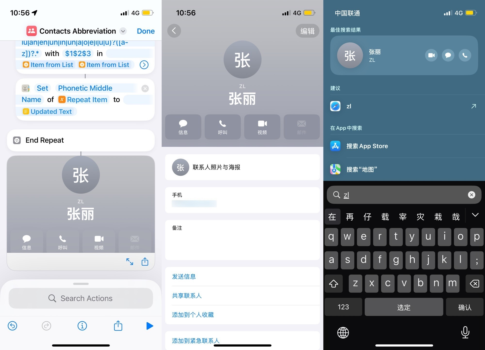

# Contacts 设置联系人首字母缩写

- [Shortcuts 动作 20251103 更新：支持复姓](https://www.icloud.com/shortcuts/25130023b9cb49679a1bd7644b8513b6)
- [Shortcuts 动作下载](https://www.icloud.com/shortcuts/5125f4fe4db94f439f6ee54883ed8f11)

中文环境中，不少人习惯通过姓名拼音首字母缩写查找联系人，但 iPhone 原生并不支持此功能（截至本文档编写之日 20251031）。

本方案可自动生成缩写并置于不影响日常使用的联系人信息字段中。默认将缩写添加至中间名的拼音字段，盖中文人名通常无中间名，此物可挪来一用，读者也可选用其他字段。

出处：[《通过拼音首字母缩写搜索 iPhone 联系人（Shortcuts 解）》](https://utgd.net/article/21282)。

